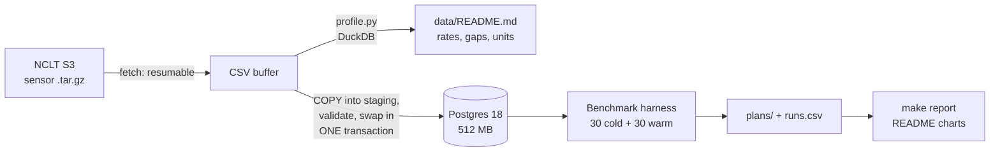
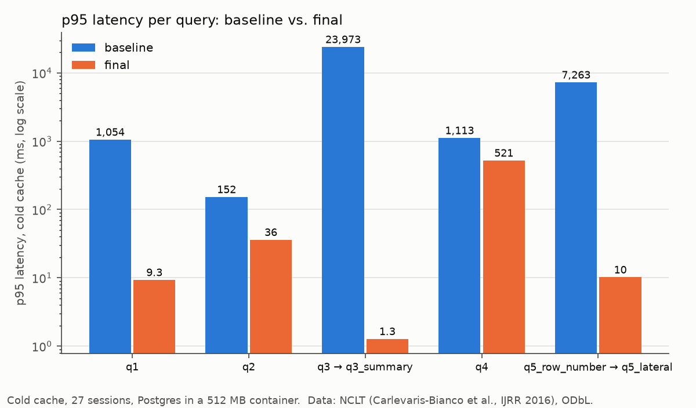
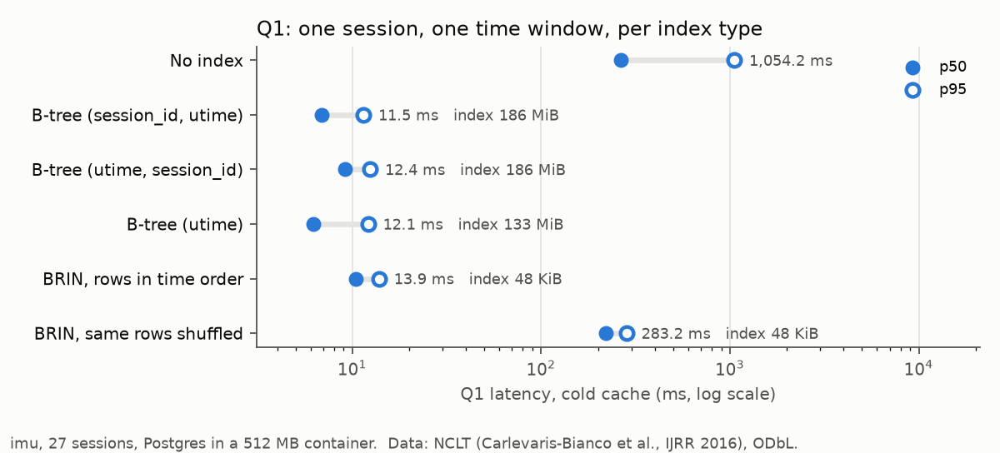
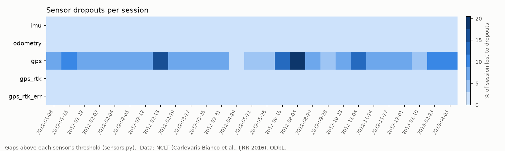

# NCLT Query Lab

**Making time-series queries over 21.9M rows of real robot sensor data fast in Postgres 18, under a 512 MB memory cap, and proving it with before/after measurements.**

> **Status:** loader, benchmarks and results are complete. Still open: the interactive Explorer, the Parquet export for downstream analysis, and one planner investigation (see [What failed](#what-failed-and-why)).
> Every number below was measured. Estimates are labeled as estimates.

[](https://codespaces.new/rkv-freelancer/NCLT-Query-Lab)

**Results at a glance** (cold-cache p95, before → after):

| Time-window query | Per-session report | Last 100 per session | COPY vs row-by-row load |
|---|---|---|---|
| 1,054 ms → 9.3 ms (**113×**) | 24.0 s → 1.3 ms (**≈18,000×**) | 7.3 s → 10 ms (**≈710×**) | **21×** faster, 0 partial writes in 6 injected crashes |

---

## Overview

Robots log many sensors at different rates, and engineers keep asking time-based questions of those logs: *what happened between t1 and t2, where was the GPS bad, when did a sensor go silent?* Without the right indexes and query design, each question scans millions of rows.

This project loads all 27 sessions of the University of Michigan **NCLT** dataset into **Postgres 18** inside a 512 MB container, measures eight realistic queries with no indexes, then makes them fast with indexes, rewrites and precomputed tables. Every change is backed by `EXPLAIN (ANALYZE, BUFFERS)` plans and p50/p95 latency over 30 cold and 30 warm runs.

## Objectives and outcomes

| # | Objective | Outcome |
|---|---|---|
| O1 | Stream every session into Postgres without reading whole files into memory | `COPY` at **453K rows/s**, 21× row-by-row `INSERT`; 26 sessions (20.9M rows) loaded in 104 s |
| O2 | Reload a session without duplicates or partial writes | Row counts match the CSVs after repeated loads; **6 injected crashes, 0 partial writes** |
| O3 | Reproducible no-index baseline | 30 cold + 30 warm runs per query, plans saved in `plans/baseline/` |
| O4 | Cut p95 on the selective queries | Q1 113×, Q2 4.2×, Q4 2.1×, Q5 ≈710× |
| O5 | Compare B-tree and BRIN | BRIN within 1.5× of the B-tree at 1/4,000 the size, until rows are shuffled |
| O6 | Show when an index does *not* help (Q3) | Summary table: 24.0 s → 1.3 ms; no index can avoid reading every row |
| O7 | Make every result reproducible | `make bench` re-measures, `make report` redraws every chart |

## Dataset

| | |
|---|---|
| **Source** | [NCLT](https://robots.engin.umich.edu/nclt/): a Segway robot driven around the University of Michigan North Campus, 27 sessions over 15 months (2012-01-08 to 2013-04-05) |
| **Used here** | All 27 sessions, sensor CSVs only. Real data only, no synthetic rows |
| **Rows** | **21.9M**: odometry 14.1M, IMU 6.2M, GPS 954K, RTK GPS 326K, RTK error 326K |
| **Measured rates** | Odometry ~108 Hz, IMU ~47 Hz, GPS ~8 Hz, RTK GPS bursts averaging ~2.5 Hz |
| **Format notes** | No header rows; `utime` in microseconds; latitude/longitude in radians |

Data-quality rules (dropout thresholds, duplicate timestamps, fix modes, a corrupt (0, 0) GPS reading) are documented with evidence in [`data/README.md`](data/README.md).

## Architecture



Postgres 18 (with PostGIS) and the Python app run as two containers from `docker-compose.yml`. Postgres is capped at **512 MB with no swap**, with `shared_buffers = 128MB`. The same setup runs in a dev container, in Codespaces, and in CI.

## Tech stack

| Purpose | Tool | Why |
|---|---|---|
| Database | **Postgres 18** + PostGIS + `pg_stat_statements` | Skip scan and async I/O in 18 change the plans studied here |
| Language / packaging | **Python 3.12**, **uv** | Reproducible from `uv.lock` |
| Driver | **psycopg 3** | Native streaming `COPY` |
| Profiling | **DuckDB** | Queries the raw CSVs in place |
| Charts | **matplotlib** | `make report` |
| Tests / lint | **pytest**, **ruff** | Integration tests against a real Postgres |
| Environment / CI | **Docker Compose**, dev container, **GitHub Actions** | Same setup everywhere |

**Deliberately not used:** pandas for loading (reads whole files into memory), ORMs (the point is to see and tune the SQL), and config tuning before the baseline.

## The queries

| # | Question | Pattern |
|---|---|---|
| Q1 | IMU readings in one session between t1 and t2 | Time-range scan |
| Q2 | RTK fixes whose error is above N m | Join on time + filter |
| Q3 | Distance, duration and top speed per session | Full aggregate |
| Q4 | GPS dropouts longer than 2 s | `LAG` window over time order |
| Q5 | Last 100 IMU readings per session | Top-N per group |
| Q6 | GPS fixes within a radius of a point | Spatial search (PostGIS) |
| Q7 | RTK error per 25 m cell and season | Spatial aggregate |
| Q8 | Robot position where each GPS dropout began | Equality join |

## Approach

1. **Load:** for each session, `COPY` every CSV into unlogged staging tables, check row counts against the file, then swap into the final tables in **one transaction**. Duplicate timestamps follow a last-row-wins rule (never averaged). A crash hook (`NCLT_CRASH_AT`) kills the loader at the first `COPY`, the last `COPY` and mid-swap, on a fresh load and on a reload.
2. **Baseline:** no indexes. Each query runs 30 times cold (Postgres restarted before each run) and 30 times warm, with fixed parameters (`bench/params.json`, seed 42). Plans go to `plans/<label>/`.
3. **One change per run:** B-tree vs BRIN (then BRIN on a shuffled copy), key-order variants, Postgres 18 skip scan, rewrites (`LATERAL`, filter-first), a summary table and a materialized view.
4. **Final:** the winners combined, with primary keys on `(session_id, utime)` (`sql/experiments/final.sql`).

## Prediction vs. measured

| | Predicted (before measuring) | Measured |
|---|---|---|
| Rows | 4.8M for 5 sessions (~0.96M per session) | 21.9M for 27 sessions (~0.81M per session) |
| B-tree on `(session_id, utime)` | ~35 B/entry | 186 MiB for 6.2M imu rows (~31 B/entry) |
| BRIN on the same columns | kilobytes to low MB | **48 KiB** |

## Results

Measured on an Apple Silicon laptop (10 cores) with Postgres 18 in OrbStack, at git `b16cff4`. Raw timings are in `reports/bench/runs.csv`, plans in `plans/`, index sizes in `reports/bench/setups.csv`.

**Load throughput** (one IMU file, 269,979 rows, median of 3 runs)

| Method | Rows/s |
|---|---|
| Row-by-row `INSERT` | 21,684 |
| `executemany` | 59,548 |
| `COPY` (streamed) | **452,769** |

**Query latency** (cold cache; Q6–Q8 compared against their own no-index baseline, `spatial_base`)

| Query | p95 before | p95 after | Speedup | What changed |
|---|---|---|---|---|
| Q1 | 1,054 ms | 9.3 ms | 113× | Primary key `(session_id, utime)`: 54 pages read instead of 88,459 |
| Q2 | 152 ms | 36 ms | 4.2× | Join-key and `error_m` indexes |
| Q3 | 23,973 ms | 1.3 ms | ≈18,000× | 27-row summary table (no index can help) |
| Q4 | 1,113 ms | 522 ms | 2.1× | Index supplies time order, removing a sort that spilled to disk |
| Q5 | 7,263 ms | 10 ms | ≈710× | `LATERAL` rewrite: 128 pages instead of 88,459 |
| Q6 | 215 ms | 97 ms | 2.2× | GiST index on `geom` |
| Q7 | 250 ms | 3.0 ms | 83× | Materialized view `gps_grid_stats` |
| Q8 | 60 ms | 17 ms | 3.4× | Primary key on gps: 88 exact lookups |



**Index choices for Q1** (cold cache)

| Index | Size | Build | p50 | p95 |
|---|---|---|---|---|
| None | | | 263 ms | 1,054 ms |
| B-tree `(session_id, utime)` | 186 MiB | 3.5 s | 6.9 ms | 11.5 ms |
| B-tree `(utime)` | 133 MiB | 2.3 s | 6.2 ms | 12.1 ms |
| B-tree `(utime, session_id)` | 186 MiB | 3.7 s | 9.1 ms | 12.4 ms |
| BRIN `(session_id, utime)`, rows in time order | **48 KiB** | 1.1 s | 10.4 ms | 13.9 ms |
| BRIN, same rows shuffled | 48 KiB | | 220 ms | 283 ms |

- BRIN is ~4,000× smaller than the B-tree and only 1.5× slower at the median, as long as the loader keeps rows in time order (`pg_stats.correlation` = 1.00). On shuffled rows it reads the whole table.
- `(utime)` alone matches `(session_id, utime)` at 29% less space, because sessions never overlap in time.
- Postgres 18 skip scan: the `(session_id, utime)` index served a utime-only filter in 8.2 ms (p50).



**Sensor dropouts:** only the regular GPS really drops out: 88 times across 26 of 27 sessions, 3.0 hours in total (median 7.9% of a session).



## What failed and why

- **The filter-first rewrite of Q2 changed nothing.** It produced the same plan in every run: the planner already applies the filter before the join.
- **Adding a B-tree made Q5 slower** (median 2.05 s → 2.25 s). The `row_number()` version still numbers all 6.2M rows. Only the `LATERAL` rewrite, which lets Postgres stop after 100 rows per session, used the index well.
- **Q2's plan is fragile.** With its own indexes it ran in 8.0 ms (nested loop with index lookups). In the final setup, and with a covering `error_m` index, Postgres chose a hash join and a full scan of `gps_rtk` instead (24–30 ms). Likely cause: different table statistics between runs. Still under investigation.
- **"Index Only Scan" on Q4 read more pages than the table** (18,299 vs 14,688). Likely heap fetches from a stale visibility map after `make spatial` rewrote `gps`; to confirm with `VACUUM` and a rerun.
- **Warm runs weren't warm for full scans.** Under the cap, a "warm" baseline Q1 still read 87,895 of 88,459 pages from outside `shared_buffers`. That's why the headline numbers are cold.
- **The PostGIS step crashed on a corrupt reading:** one RTK fix labeled "3D fix" at latitude 0, longitude 0. Positions now count only if the fix mode is at least 2D and the point isn't (0, 0).

## What breaks at 10×

**These are estimates scaled from the measurements above, not measurements.** At ~220M rows with the same 512 MB:

| Today | At 10× (estimate) | What I'd change |
|---|---|---|
| Final indexes total 704 MiB | ~7 GiB; almost no index pages stay cached | Partition by session or month; BRIN on old, append-only partitions |
| Loading takes 104 s | ~17 minutes | Load sessions in parallel, one transaction each |
| Summary table rebuild takes 20 s | ~3 minutes | Update each session's summary row inside the loader's transaction |
| Window queries (Q4) read every row | ~10× slower, ~5 s | Compute dropouts at load time (already stored in `sensor_gaps`) |
| All analysis runs in Postgres | Large scans compete with lookups | Export to Parquet and run heavy analysis in DuckDB |

The first thing to break is likely cache residency: at 10×, even a single primary key no longer fits in `shared_buffers`, so every cold lookup pays for disk reads.

## Deliverables

- [x] Crash-safe, idempotent loader with reconciliation and crash tests (`make ingest`)
- [x] Benchmark harness reproducing every number (`make bench`)
- [x] `EXPLAIN (ANALYZE, BUFFERS)` plans for every run (`plans/`)
- [x] Results tables and charts generated from data (`make report`)
- [x] Integration tests run in CI against Postgres 18
- [x] Data profile with rates, gaps, units and provenance (`data/README.md`)
- [x] "What failed" and "What breaks at 10×"
- [ ] Interactive Explorer sweep (`make sweep`, `make explorer`)
- [ ] Parquet export for downstream analysis (`make export`)

## Getting started

**Option A: GitHub Codespaces.** Click the badge above, choose a 2-core machine, and wait for the dev container to build.

**Option B: locally.** Requires Docker (OrbStack or Docker Desktop) and VS Code with the Dev Containers extension. Run **Dev Containers: Reopen in Container**.

> On Buildx 0.37.2+, Compose-based dev containers can fail with `additional privileges requested`. Set `export BUILDX_BAKE_ENTITLEMENTS_FS=0` and restart VS Code.

Then, in the container's terminal:

```bash
make check                    # lint + tests
make schema
make ingest DATE=--all        # download and load all 27 sessions (~3 GB download)
make gaps && make spatial
make bench-params
make bench LABEL=baseline     # then one run per experiment, see sql/experiments/
make report
```

| Command | Does |
|---|---|
| `make check` | ruff + pytest |
| `make schema` / `make reset-db` | Create / drop tables |
| `make ingest DATE=...` | Fetch, profile and load sessions (resumable) |
| `make loadbench DATE=...` | `COPY` vs `executemany` vs row-by-row |
| `make gaps` | Rebuild `sensor_gaps` and reconcile with the profile |
| `make spatial` / `make spatial-check` | PostGIS columns and sanity checks |
| `make bench LABEL=... [SETUP=...] [QUERIES=...]` | One labeled benchmark run |
| `make bench-summary LABEL=...` | p50/p95 for a run |
| `make report` | Regenerate the charts |
| `make psql` | Open a SQL shell |

## Repository layout

```text
NCLT-Query-Lab/
├── .devcontainer/         # dev container (Codespaces and local)
├── .github/workflows/     # CI
├── bench/                 # fixed query parameters, sweep config
├── data/                  # gitignored except README.md
├── plans/<label>/         # EXPLAIN (ANALYZE, BUFFERS) per run and cache state
├── reports/               # charts, profile, benchmark CSVs
├── scripts/download.sh
├── sql/                   # schema, spatial, queries/, experiments/
├── src/nclt_lab/          # fetch, loader, gaps, benchmarks, report, ...
├── tests/
├── Dockerfile             # multi-stage: base, development, production
├── db.Dockerfile          # Postgres 18 + PostGIS
├── docker-compose.yml     # Postgres (512 MB cap) + app
└── Makefile
```

## Data license and attribution

This project uses the **NCLT dataset**, made available under the [Open Database License (ODbL) 1.0](http://opendatacommons.org/licenses/odbl/1.0/); individual contents are under the Database Contents License (DbCL) 1.0. Raw data is not redistributed here: the loader fetches it from the original source.

> Nicholas Carlevaris-Bianco, Arash K. Ushani, and Ryan M. Eustice. *University of Michigan North Campus Long-Term Vision and Lidar Dataset.* International Journal of Robotics Research, 2016.
