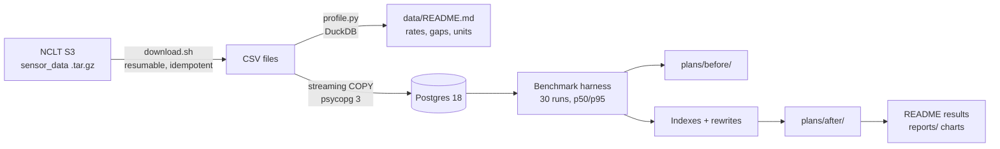

# NCLT Query Lab

**Making time-series queries over real robot sensor data fast in Postgres, and proving it with before/after measurements.**

> **Status: in progress.** Current phase: environment setup and data profiling.
> Every number marked `[TBD]` is filled in only after it has been measured. Nothing in this README is estimated without saying so.

[](https://codespaces.new/<your-username>/nclt-query-lab)

---

## Overview

Robots log many sensors at different rates, and engineers constantly ask time-based questions of those logs: *what happened between t1 and t2, where were the GPS errors, where did a sensor go silent?* Without the right indexes and query design, each question scans millions of rows.

This project loads real sensor data from the University of Michigan **NCLT** dataset into **Postgres 18**, runs five realistic queries with no indexes, and then makes them fast with indexes and query rewrites. Every fix is backed by `EXPLAIN (ANALYZE, BUFFERS)` plans and p50/p95 latency, including one case where an index is deliberately **not** the answer.

## Goals and objectives

**Goals**

- Practice the query-optimization loop used in production: measure, read the plan, change one thing, re-measure.
- Learn how index choice depends on data layout (B-tree vs. BRIN, physical order, Postgres 18 skip scan).
- Build a loader that is fast, streaming, idempotent, and verified.

**Objectives**

| # | Objective | Metric | Target |
|---|---|---|---|
| O1 | Stream all selected sessions into Postgres without reading whole files into memory | Load throughput (rows/s), `COPY` vs. `executemany` vs. row-by-row `INSERT` | `[TBD]` |
| O2 | Reload a session without creating duplicates | Row counts in Postgres = data lines in the CSVs, after repeated loads | Exact match |
| O3 | Establish a reproducible no-index baseline | p50/p95 over 30 runs per query, warm and cold cache | Baseline recorded |
| O4 | Cut p95 latency on Q1, Q2, Q4, Q5 | p95 before → after | Set per query **after** the baseline |
| O5 | Compare B-tree and BRIN on `(session_id, utime)` | Index size, build time, p95 | Both measured |
| O6 | Show when an index does *not* help (Q3) | p95 with index vs. with a summary table | Summary table wins |
| O7 | Make every result reproducible | `make bench` regenerates all tables | One command |

## Dataset

| | |
|---|---|
| **Source** | [NCLT](https://robots.engin.umich.edu/nclt/): a Segway robot driven around the University of Michigan North Campus, 27 sessions over 15 months (Jan 2012 – Apr 2013) |
| **Used here** | Sensor CSVs only: IMU (`ms25.csv`, ~100 Hz), wheel odometry (~100 Hz), consumer GPS (~5 Hz), RTK GPS (~1 Hz), RTK error vs. ground truth |
| **Scope** | Five sessions spread across seasons, which allows a seasonal GPS comparison |
| **Size** | ~520 MB compressed; ~5M real rows (estimate, replaced after profiling), topped up with simulated rows past 10M for scale tests |
| **Format notes** | No header rows; `utime` in microseconds; GPS latitude/longitude stored in radians (loaded raw, converted downstream) |

| Session | Season |
|---|---|
| 2012-01-08 | Winter |
| 2012-05-11 | Spring |
| 2012-08-04 | Summer |
| 2012-11-17 | Fall |
| 2013-02-23 | Winter |

## Architecture



Everything runs in a dev container: Postgres 18 in one container, Python in the other, defined by `docker-compose.yml`. The same files run in GitHub Codespaces, locally, and in CI.

## Tech stack

| Purpose | Tool | Why this choice |
|---|---|---|
| Database | **Postgres 18** + `pg_stat_statements` | Industry-standard OLTP database; 18 adds B-tree skip scan and asynchronous I/O, both of which change the plans studied here |
| Language | **Python 3.12** | |
| Packaging | **uv** (`pyproject.toml` + `uv.lock`) | Fast, reproducible, lockfile-based |
| Database driver | **psycopg 3** | Native `COPY` support for streaming loads |
| Profiling | **DuckDB** | Queries CSVs in place, no load step |
| Charts | **matplotlib** | Static PNGs generated by `make report` |
| Testing | **pytest** | Loader idempotency and reconciliation tests against a real Postgres |
| Linting | **ruff** | Linting and formatting in one tool |
| Environment | **Docker Compose + dev container** | Identical setup in Codespaces, locally, and in CI |
| CI | **GitHub Actions** | Lint, tests against Postgres 18, production image build |
| Cloud dev | **GitHub Codespaces** | Runs the dev container with no local storage needed |

**Deliberately not used:** pandas for loading (it reads whole files into memory; `COPY` streams), ORMs (the point is to see and tune the SQL), and config tuning before the baseline (it would make before/after numbers meaningless).

## The five queries

| # | Question | Pattern | Expected fix |
|---|---|---|---|
| Q1 | IMU readings in session X between t1 and t2 | Time-range scan | Composite B-tree or BRIN on `(session_id, utime)` |
| Q2 | GPS fixes where RTK error > N m | Join on time + filter | Index on `utime`, join rewrite |
| Q3 | Per-session odometry summary (distance, duration, max speed) | Full aggregate | **An index won't help:** summary table / materialized view |
| Q4 | Sensor gaps > 2 s per session | `LAG` window over ordered `utime` | An index that supplies the order, avoiding the sort |
| Q5 | Last 100 readings per session | Top-N per group | `LATERAL` + index |

## Approach

1. **Load:** stream each CSV into per-sensor tables with `COPY` in chunks. Benchmark against `executemany` and row-by-row `INSERT`. Reload = delete + copy in one transaction. Reconcile row counts. `VACUUM ANALYZE`.
2. **Baseline:** no indexes. Each query runs 30× with varied parameters; p50/p95 reported separately for warm and cold cache; plans saved to `plans/before/`.
3. **Fix:** B-tree vs. BRIN (checking `pg_stats.correlation`), then break BRIN on purpose by interleaving sessions. Test Postgres 18 skip scan. Rewrite Q2, Q3, Q5. Plans saved to `plans/after/`.
4. **Tune (optional):** one setting at a time, e.g. `work_mem` and Q4's sort spilling to disk.
5. **10x (stretch):** simulated rows past 100M, partitioning by `session_id`, and a "what breaks first" write-up.

**Schema choice:** one table per sensor (`imu`, `gps`, `gps_rtk`, `gps_rtk_err`, `odometry`), each keyed by `(session_id, utime)`, plus `dim_session`. Rejected alternatives: one wide table (mostly NULLs, since sensors run at different rates) and one long key-value table (~10× more rows; every query must pivot).

## Prediction (back-of-envelope, written before measuring)

```
Per session (~1.29 h ≈ 4,650 s):
  IMU 100 Hz ≈ 465k rows · odometry 100 Hz ≈ 465k · GPS 5 Hz ≈ 23k · RTK 1 Hz ≈ 5k
  ≈ 0.96M rows/session × 5 sessions ≈ 4.8M rows

Heap:   ~120 B/row × 4.8M  ≈ 0.6 GB
B-tree on (session_id, utime): ~35 B/entry ≈ 170 MB
BRIN on the same columns:      kilobytes to low MB, if rows are physically time-ordered
```

## Results

> Filled in after measurement. Hardware and machine type are recorded with every table, because shared cloud VMs add noise.

**Load throughput**

| Method | Rows/s | Notes |
|---|---|---|
| Row-by-row `INSERT` | `[TBD]` | |
| `executemany` | `[TBD]` | |
| `COPY` (streamed) | `[TBD]` | |

**Query latency (warm cache)**

| Query | p95 before | p95 after | Change | Fix |
|---|---|---|---|---|
| Q1 | `[TBD]` | `[TBD]` | `[TBD]` | |
| Q2 | `[TBD]` | `[TBD]` | `[TBD]` | |
| Q3 | `[TBD]` | `[TBD]` | `[TBD]` | |
| Q4 | `[TBD]` | `[TBD]` | `[TBD]` | |
| Q5 | `[TBD]` | `[TBD]` | `[TBD]` | |

**B-tree vs. BRIN on `(session_id, utime)`**

| Index | Size | Build time | Q1 p95 | After interleaving sessions |
|---|---|---|---|---|
| B-tree | `[TBD]` | `[TBD]` | `[TBD]` | `[TBD]` |
| BRIN | `[TBD]` | `[TBD]` | `[TBD]` | `[TBD]` |

**Charts** (generated by `make report`)

- `reports/p2_before_after_p95.png`: p95 and index size, before vs. after
- `reports/p2_rtk_error_map.png`: GPS fixes along the route, colored by RTK error
- `reports/p2_rtk_error_by_season.png`: GPS quality by season on the same campus
- `reports/p2_sensor_gaps_heatmap.png`: gaps per sensor × session

## What failed and why

`[TBD]`: approaches that didn't work, with the evidence (plans, numbers).

## What breaks at 10x

`[TBD]`: measured at a larger simulated row count, with the first bottleneck identified.

## Deliverables

- [ ] Streaming, idempotent loader with reconciliation (`make load`)
- [ ] Benchmark harness reproducing every number (`make bench`)
- [ ] `EXPLAIN (ANALYZE, BUFFERS)` plans for every query, before and after (`plans/`)
- [ ] Results tables above, filled with measured values
- [ ] Charts regenerated from data (`make report`)
- [ ] Tests for loader idempotency and reconciliation, run in CI against Postgres 18
- [ ] Data profile with rates, gaps, units, and provenance (`data/README.md`)
- [ ] "What failed" and "What breaks at 10x" sections, with evidence

## Getting started

**Option A: GitHub Codespaces (no local install or storage)**

1. Click **Open in GitHub Codespaces** above, choose a 2-core machine, and wait for the dev container to build.
2. In the terminal:

```bash
make schema
make download DATE="2012-01-08 2012-05-11 2012-08-04 2012-11-17 2013-02-23"
make profile DATE=2012-01-08
make check
```

**Option B: locally**

Requires Docker (OrbStack or Docker Desktop) and VS Code with the Dev Containers extension. Open the folder and run **Dev Containers: Reopen in Container**, then use the same commands.

> On Buildx 0.37.2+, Compose-based dev containers can fail with `additional privileges requested`. Until [docker/compose#14286](https://github.com/docker/compose/pull/14286) ships, set `export BUILDX_BAKE_ENTITLEMENTS_FS=0` in your shell and restart VS Code.

**Make targets**

| Command | Does |
|---|---|
| `make check` | ruff + pytest |
| `make schema` | Create tables and extensions |
| `make download DATE="..."` | Download and extract sessions (resumable) |
| `make profile DATE=...` | Profile one session's CSVs with DuckDB |
| `make load` | Load sessions into Postgres *(Phase 1)* |
| `make bench` | Run the benchmark harness *(Phase 2)* |
| `make report` | Regenerate charts *(after results)* |
| `make psql` | Open a SQL shell |
| `make reset-db` | Drop all tables |

## Repository layout

```text
nclt-query-lab/
├── .devcontainer/        # dev container config (Codespaces and local)
├── .github/workflows/    # CI
├── data/                 # gitignored except README.md and SHA256SUMS
├── plans/before/         # EXPLAIN output, no indexes
├── plans/after/          # EXPLAIN output, after fixes
├── reports/              # generated charts
├── scripts/download.sh   # resumable, idempotent downloader
├── sql/schema.sql
├── src/nclt_lab/         # loader, profiler, benchmark, report
├── tests/
├── Dockerfile            # multi-stage: base, development, production
├── docker-compose.yml    # Postgres 18 + app
└── Makefile
```

## Data license and attribution

This project uses the **NCLT dataset**, made available under the [Open Database License (ODbL) 1.0](http://opendatacommons.org/licenses/odbl/1.0/); individual contents are under the Database Contents License (DbCL) 1.0. Raw data is not redistributed in this repository: `scripts/download.sh` fetches it from the original source, and `data/SHA256SUMS` records exactly what was downloaded.

> Nicholas Carlevaris-Bianco, Arash K. Ushani, and Ryan M. Eustice. *University of Michigan North Campus Long-Term Vision and Lidar Dataset.* International Journal of Robotics Research, 2016.

## Next

**D1: Multi-sensor time alignment.** The same sensor streams, aligned with as-of joins (pandas `merge_asof` vs. DuckDB `ASOF JOIN`) under a 512 MB memory cap, visualized on one timeline with Rerun.